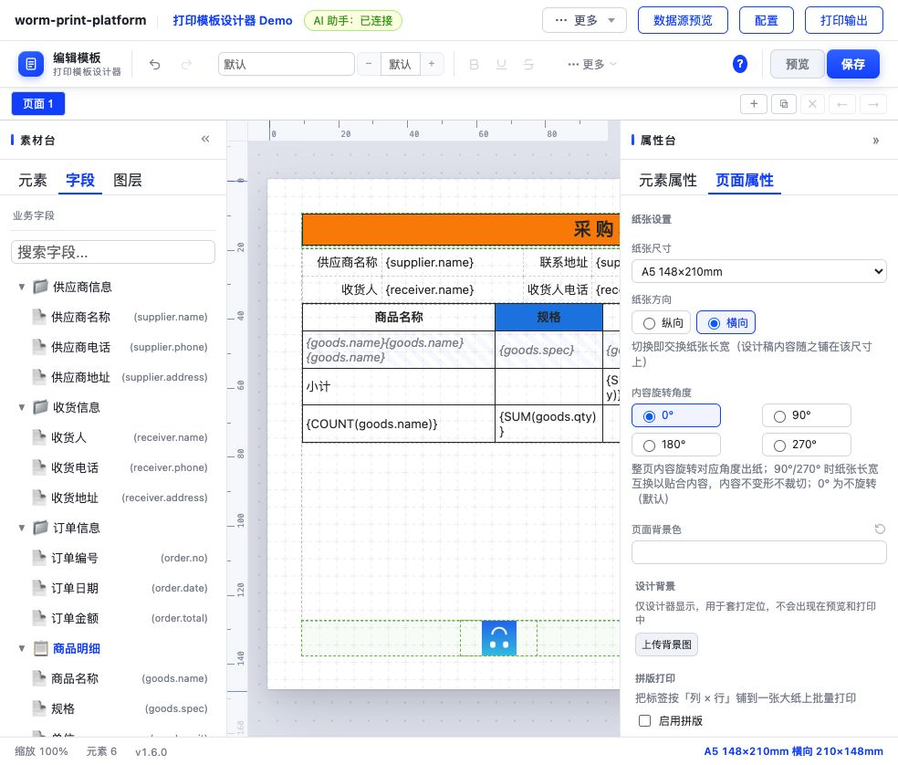
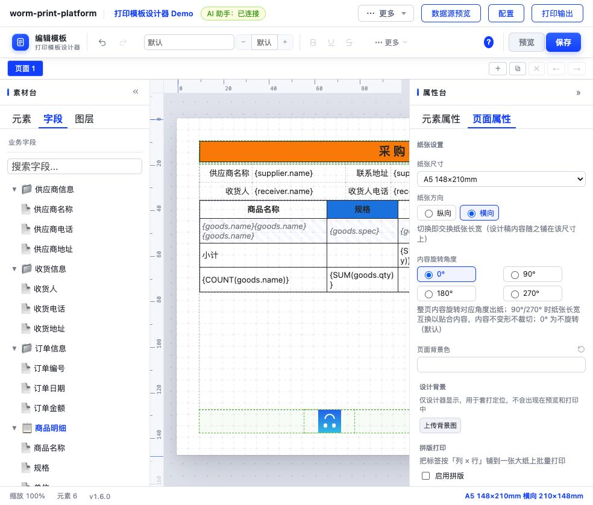
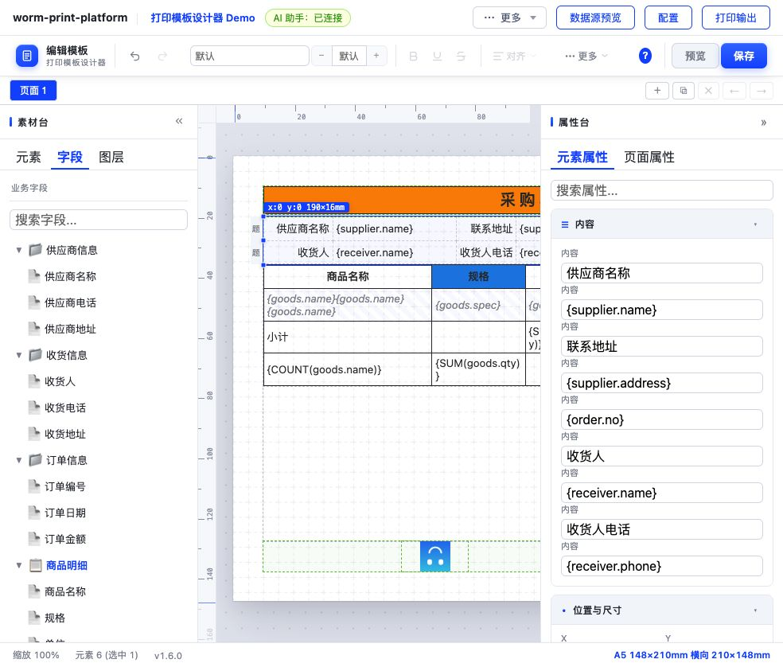

# Gitee 用户反馈问题复现报告

> 本报告把「恢复问题」按**复现 / 核验**理解：拉取 Gitee Issues 后，基于当前代码逐条验证问题是否仍然存在，并给出代码级证据与修复落点。

## 一、复现概况

- **数据来源**：Gitee API `issues?state=all`，共 4 条，其中 **3 条开放的用户反馈**（IKWHUY / IKWDYQ / IKWC7W），1 条已关闭的安全扫描摘要（非用户反馈，不纳入）。
- **代码基线**：`v1.6.0`，commit `1e125f2`。
- **环境准备**：原有 `packages/canvas/dist` 停留在 v1.5.4，已重新构建 core / plugin-kit / canvas / plugin-echarts / plugin-data-preview，确认 dist 版本常量为 `1.6.0`。
- **复现手段**：Vue3 demo（`http://localhost:9331`，浏览器实测）+ 单元测试 + Node 脚本 + 源码逐行核对。

## 二、结论汇总

| Issue | 标题 | Gitee 状态 | 当前代码结论 |
|---|---|---|---|
| **IKWHUY** | 是否可以表格动态列 | open / 未实现 | ❌ **完全未实现**，问题仍存在；仅有「多模板」规避路径 |
| **IKWDYQ** | 图表插件中优化显示效果 | open / 维护者称「解决了」 | ✅ **已修复**（v1.6.0），93 项测试通过 |
| **IKWC7W (a)** | 字段列表不显示后面的小字 | open / 无评论 | 🟡 **已实现但默认未开启**，宿主配置后满足 |
| **IKWC7W (b)** | 字段父节点加预览按钮 | open / 无评论 | 🟡 **部分实现**：弹窗能力齐备，用户要的「父节点按钮」被移除 |
| **IKWC7W (c)** | 开放自定义函数注册接口 | open / 无评论 | 🟡 **部分实现**：设计器侧可注册，出纸渲染链路无入口 |

## 三、逐项复现

### Issue 1 — IKWHUY「是否可以表格动态列」

**用户诉求**：表格有物料名称 / 批次号 / 规格型号 / 色号等列，希望打印时指定隐藏某些列（如无色号数据时不打印色号列）。维护者回复：「当前不支持动态列，可以使用多模板解决，后续考虑方案进行实施」。

**复现步骤与现象**
1. 设计器选中表格元素 → 右侧属性面板只有「内容」「位置与尺寸」「列宽 (mm)（列1～列6）」。
2. 浏览器实测属性面板文本搜索：`列宽 = true`，`显隐/隐藏列/显示列/条件列/列可见 = false`。
3. 表格右键菜单仅有「在左侧插入列 / 在右侧插入列 / 删除列」。

**代码证据**
- `packages/core/src/designer/types.ts:209-265` `TableCell` 无 `visible/hidden/display` 字段；`:423-424` 列集合由 `tableColWidths` 长度隐式定义，无列 ID。
- `packages/core/src/render/html-generator.ts:836-838` 单元格过滤只处理合并；`:922-923` `colgroup` 全量输出。
- `packages/canvas/src/shell/table-props.ts:192-206` 仅「列宽」逐列输入；`shell/table.ts:660-662` 右键仅物理增删列。
- 全仓无 `visibleWhen / showWhen / hiddenWhen / columnHidden` 等条件列能力；`IF` 函数只能返回文本，不能隐藏整列。
- 多模板规避路径确实存在：`packages/core/src/print/multi-template.ts`。

**结论**：❌ 完全未实现，Issue 描述的问题在当前代码上可稳定复现。

**最小修复落点**：`designer/types.ts`（加列元数据 `visible?: boolean | string`）→ `render/data-binder.ts:161,187`（绑定期过滤列并缩减列宽）→ `render/html-generator.ts:836-838,922-923`（渲染与 colgroup 同步）→ `render/pagination-engine.ts:128,250`（重算尺寸）→ `canvas/shell/table-props.ts:139-210` 与 `table.ts:660-662`（属性面板与右键菜单）→ `contract/src/schema/template.ts`（契约校验）。

---

### Issue 2 — IKWDYQ「图表插件中优化显示效果」

**用户诉求**：百度图表插件的数据标签显示效果（截图为柱状图 / 饼图）。维护者回复「解决了」。

**验证结果**
```
> npm run test -w @worm-print-platform/plugin-echarts
 Test Files  12 passed (12)
      Tests  93 passed (93)
```

**代码证据（修复确已落地）**
- `marketplace/plugins/echarts/src/label.ts:20-21` 定义 `offset?: [number, number]` 并注明旧键迁移；`:165-179` `normalizeLabelOffsetInPlace` 把 `offsetX/offsetY` 迁到 `offset:[x,y]` 并删旧键。
- 三处迁移齐全：读取 `label.ts:195`、写回 `label.ts:240`、出图归一 `normalize.ts:40-49`。
- UI 写入原生键：`ui.ts:521-535` `commit({ offset: [x, y] })`。
- 仪表盘走 `detail`：`label.ts:181-184`、`normalize.ts:41`。
- 测试覆盖：`label.test.ts:85-127`、`normalize.test.ts:49-65`、`renderer.test.ts:67,86-87`（SSR 坐标断言）。

**结论**：✅ 已修复，随 v1.6.0 发布。残余能力缺口（非本 Issue 承诺范围）：radar / funnel 不支持 offset，无富文本 label、无逐项回调、无标签避让策略。

---

### Issue 3 — IKWC7W「设计器细节优化」

#### (a) 字段列表不要显示后面的小字

**复现现象（默认态）**：「字段」页签显示 `供应商名称 (supplier.name)`、`订单编号 (order.no)` 等括号小字，与用户截图一致。

**配置验证**：打开「配置」弹窗 →「字段显示」提供三态（两者都显示 / 只显示中文名 / 只显示字段 key），默认「两者都显示」；切换为「只显示中文名」并完成后，**所有 key 小字立即消失**。

**代码证据**
- 三态归一化单一真源：`packages/plugin-kit/src/expression-editor.ts:100-104`（非法值回退 `both`）；表达式弹窗 `:379`。
- 素材台字段树：`packages/canvas/src/shell/panels.ts:108-110`（`mode = st.fieldDisplay ?? 'both'`）、`:166-170`（`mode !== 'label'` 才挂 `.node-key`）。
- 默认与契约：`packages/canvas/src/print-designer.ts:152`（state 初始化 `'both'`）、`host-contract.ts:25,66,180`；demo 接入 `demos/apps/vue3/src/App.vue:275-283`。

**结论**：🟡 已实现，但默认 `both`（为存量零变化的刻意设计）。宿主传 `field-display="label"` 即可满足用户诉求，无需改代码。

#### (b) 字段父节点加预览按钮查看数据源

**复现现象**：字段树分组头（供应商信息 / 收货信息 / 商品明细）只有展开图标 + 文件夹图标 + 名称，**没有预览按钮**。

**代码证据**
- `packages/canvas/src/shell/panels.ts:128-138` 分组 header 无按钮。
- `marketplace/plugins/data-preview/src/index.ts:1-4` 明确「只提供触发 API，不自动往设计器字段树挂按钮」。
- 设计文档 `docs/superpowers/specs/2026-11-19-data-preview-design.md:3-6` 明确「未采用 FieldActionUI 贡献点与 canvas 字段树按钮方案；该贡献点及挂载点已全部移除」。
- 弹窗能力齐备：`data-preview/src/ui.ts:103-172`（`groupKey` 分组、总览 + 子 tab、表单/表格、跳转、Esc/遮罩关闭）；`types.ts:51-67` 支持 `groupKey`；但明确不分页（`README.md:36`）。
- demo 改为宿主顶部入口：`demos/apps/vue3/src/App.vue:49,414-424`（「数据源预览」按钮）。
- 文档漂移：`marketplace/plugins/data-preview/README.md:3,23`、`marketplace.json:21` 仍写「字段树父节点增加按钮 / import 即注册」，与实现矛盾。

**结论**：🟡 部分实现——预览弹窗 + 宿主入口有了，但用户明确要求的「字段父节点按钮」交互没有，且文档口径不一致。

**最小修复落点**：`plugin-kit/src` 恢复字段动作贡献点 → `canvas/shell/panels.ts:128-138` 分组头渲染按钮 → `data-preview/src/index.ts` import 时注册并回传 `groupKey` → 同步修正上述文档。

#### (c) 开放自定义函数注册接口（如手机号脱敏）

**验证脚本输出**（基于 `packages/core/dist`）：
```
[设计器侧 TemplateEngine]  135****1234
[出纸侧 evaluateTemplate]  "{MASK_PHONE(phone)}"
```
设计器侧注册 `MASK_PHONE` 后脱敏成功；**出纸渲染侧不认识该函数，原样输出表达式，打印结果不会脱敏**。

**代码证据**
- 设计器侧公开：`packages/core/src/index.ts:8-30` `TemplateEngine.registerFunction()`；`:17-19`；设计器单例 `src/designer/utils/engine.ts:1-5` 经 `designer/index.ts:67` 导出。
- 出纸侧缺口：`packages/core/src/render/expression-eval.ts:30-49` `RenderEngine` 类与 `engine` 单例均为模块内私有；主入口 `index.ts:54` 只导出 `evaluateTemplate / safeEval`。三条出纸链路（浏览器预览 / 服务端 PDF / 客户端静默打印）均无法注册。
- 设计器函数列表硬编码：`plugin-kit/src/expression-editor.ts:106-116,136-173`，无 `customFunctions` 注入点。
- 文档缺失：`core/README.md:74` 仅目录注释；自定义函数被列为「非目标 / 后续项」（`docs/superpowers/specs/2026-11-19-data-preview-design.md:14,140`）。

**结论**：🟡 部分实现——用户真实诉求（打印结果脱敏）不成立。

**最小修复落点**：`core/src/render/expression-eval.ts:30-49` 导出 `registerRenderFunction()` → `core/src/index.ts:54` 附近从主入口导出 → `plugin-kit/src/expression-editor.ts:106-116,136-173` 增 `customFunctions` 并入函数列表 → `canvas/src/host-contract.ts:25,66,180` + `print-designer.ts` + `shell/controls.ts` 透传 → demo 示范 `MASK_PHONE` → 同步 README / CHANGELOG。

## 四、截图证据

| 截图 | 说明 |
|---|---|
|  | v1.6.0 默认显示 key 小字；父节点无预览按钮（对应 3a / 3b） |
|  | 配置后 key 小字全部消失（对应 3a） |
|  | 只有「列宽 (mm)」，无列显隐（对应 Issue 1） |

## 五、建议优先级

1. **Issue 1（动态列）**：唯一完全未实现且用户明确需要的功能，影响打印交付，优先级最高。
2. **IKWC7W (c) 自定义函数出纸注册**：用户给了具体用例（手机号脱敏），缺口清晰、改动集中。
3. **IKWC7W (b) 父节点预览按钮**：能力已在，只差交互入口 + 文档纠正。
4. **IKWC7W (a) 字段小字**：无需改代码，宿主配置 `field-display="label"` 即可，或产品侧决定是否改默认值。
5. **IKWDYQ**：已修复，无需处理。
